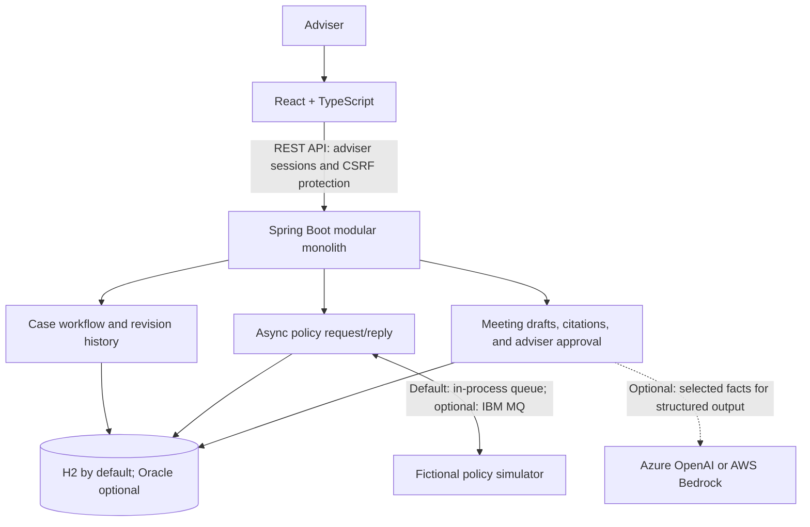

# Life & Pension Adviser Workspace

Prepare pension and life-cover meetings: record declared facts, request simulated
policy information, and review cited meeting drafts. **Fictional profiles only.
Independent of Nordea; not financial advice or a suitability assessment.**

## Architecture



The backend validates the model's selections and renders citations from saved
facts. The adviser reviews the sources before approving a briefing.

## Run locally

Requires Docker Engine and Docker Compose. The default stack uses persistent H2,
an in-process policy simulator (not IBM MQ), and no cloud AI.

```sh
docker compose --env-file /dev/null -f compose.demo.yaml up --build -d --wait
```

Open [localhost:8089](http://localhost:8089) and sign in as `adviser` with
`local-demo-password`. Open **Synthetic: Mika, sole trader** to try reviewing a
case, requesting a simulated policy, and inspecting case history.

Stop with `docker compose --env-file /dev/null -f compose.demo.yaml down`.
Omit `--volumes` to keep your data.

## Optional integrations

- **Oracle:** Copy [`.env.example`](.env.example) to `.env`, replace the placeholder
  passwords, and run `docker compose --env-file .env -f compose.oracle.yaml up --build -d --wait`.
  Open [localhost:8090](http://localhost:8090) with your configured adviser credentials.
- **IBM MQ:** Review the [IBM container licence and configuration](https://github.com/ibm-messaging/mq-container/blob/master/docs/usage.md).
  Put a reviewed Developer image (`MQ_IMAGE`) and, after accepting its terms,
  `MQ_LICENSE=accept` in `.env.mq`. Save the MQ `app` password in
  `secrets/mq-app-password`. Run:

  ```sh
  APP_PORT=8092 docker compose --env-file .env.mq -p life-pension-mq \
    -f compose.demo.yaml -f compose.mq.yaml up --build -d --wait
  ```

- **Kubernetes:** See the [deployment guide](deploy/kubernetes/README.md).

### Cloud AI

Choose **one** provider with structured-output support. Keep env files private
and never commit credentials. Keep `secrets/` private on the host (`chmod 700 secrets`)
and make the mounted credential file readable by the container user.

| Provider | Private env file and settings | Credential file |
| --- | --- | --- |
| Azure OpenAI | `.env.azure`: `AZURE_OPENAI_ENDPOINT` (HTTPS resource root), `AZURE_OPENAI_DEPLOYMENT` (deployment name) | `secrets/azure-openai-key`: resource API key |
| AWS Bedrock | `.env.bedrock`: `AWS_REGION`, `BEDROCK_MODEL_ID`, optionally `AWS_PROFILE` | `secrets/aws-credentials`: shared credentials profile with `bedrock:InvokeModel` access; prefer temporary credentials |

```sh
APP_PORT=8095 docker compose --env-file .env.azure -p life-pension-azure \
  -f compose.demo.yaml -f compose.ai-azure.yaml up --build -d --wait

# Or use Bedrock:
APP_PORT=8096 docker compose --env-file .env.bedrock -p life-pension-bedrock \
  -f compose.demo.yaml -f compose.ai-bedrock.yaml up --build -d --wait
```

Open the configured localhost port with the demo login. Draft generation sends
selected fictional facts to the provider and can incur charges. Review every
cited source before approving a briefing.

**Shared access:** `PUBLIC_DEMO_ENABLED=true` allows anonymous visitors to view
and edit the same data. Use it only with disposable fictional data. Keep
`PUBLIC_DEMO_EXTERNAL_INTEGRATIONS` off unless you have rate limits and provider
spending controls; enabling it allows public visitors to trigger paid AI calls
and permits MQ only with its simulator enabled.

## Verify

- Backend (Java 21 and Maven): `cd backend && mvn -B verify`.
- Frontend (Node 22): `cd frontend && npm ci && npm run lint && npm test && npm run build`.
- Browser tests: with the default stack running, run
  `npx playwright install chromium && npm run test:e2e` from `frontend/`.
  Use a disposable stack: tests create cases.
- Optional paid evaluation: after configuring a provider, run
  `node scripts/evaluate-ai.mjs --backend=azure --allow-paid-synthetic` from the
  repository root (or use `--backend=bedrock`). This makes up to six synthetic
  inference calls. Regular tests make no cloud calls.
