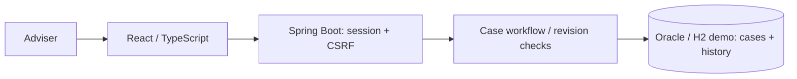

# Life & Pension Adviser Workspace

A small workspace for preparing pension and protection conversations: record
customer-declared facts, identify missing information, and track what changed.
**Fictional profiles only. Independent of Nordea; not financial advice.**

## Step 1: case workspace

- One adviser login with server-side sessions and CSRF-protected writes.
- Three synthetic cases: sole trader, employee, and career change.
- Create/edit profiles: age, employment, dependants, income, voluntary pension
  contribution, life cover, and meeting notes.
- Blank facts remain **unknown**, distinct from an explicitly declared zero.
- Draft → in review → closed, with return/reopen actions. Editing reviewed facts
  returns the case to draft; closed cases must be reopened before editing.
- Revision checks prevent overwriting changes made in another session.
- Each saved change records the adviser and a complete historical fact snapshot.

**AI briefings and IBM MQ policy integration come later; neither is implemented.**
Case status represents meeting preparation, not product suitability or approval.

## Run the demo

Requires Docker Engine and Docker Compose. The demo uses persistent **H2 in Oracle
compatibility mode**, not an Oracle server.

```sh
docker compose --env-file /dev/null -f compose.demo.yaml up --build -d --wait
```

Open **http://localhost:8089**. Sign in with **`adviser` / `local-demo-password`**.

Try it: open **Synthetic: Mika, sole trader** → **Start review** → **Edit profile** →
enter a pension contribution → save. The case returns to draft. Expand **Case
history**, then review, close, and reopen the case.

Stop while preserving data:

```sh
docker compose --env-file /dev/null -f compose.demo.yaml down
```

Use `--volumes` only to deliberately erase that stack's cases and history.

## Run with Oracle

The separate Oracle stack uses `gvenzl/oracle-free:23.26.1-slim`, a community image
with application-user provisioning and a built-in health check. Review the
[Oracle terms](https://www.oracle.com/database/free/) and
[image documentation](https://hub.docker.com/r/gvenzl/oracle-free) before starting it.

```sh
cp .env.example .env
chmod 600 .env
# Replace placeholder passwords in .env with unique local passwords.
docker compose --env-file .env -f compose.oracle.yaml up --build -d --wait
```

Open **http://localhost:8090** with your configured adviser credentials.
Stop with the same command prefix followed by `down` instead of `up --build -d --wait`.

The Oracle and H2 stacks have **separate volumes**; they do not share or migrate
cases. Database ports are not exposed. Never commit `.env`; Docker administrators
can see environment credentials. Changing bootstrap passwords does not rotate
passwords in an existing database volume.

**Locally verified on Oracle:** both migrations, the API smoke check, all five browser
tests, and exact preservation of six cases and their history across Oracle/app restart.
**Caveat:** Flyway warns that Oracle 23.26 is newer than its tested support range.
Passing local checks is not vendor-certified compatibility. Automated CI uses H2 only.

## Design



A modular monolith using Java 21, JDBC, and Flyway. Profile/status writes compare the
submitted revision in SQL and commit the new facts and history **together**, or roll
back both. EUR amounts persist as decimals with at most two decimal places.

The [case service](backend/src/main/java/fi/adviser/workspace/CaseService.java) owns
workflow and persistence; the [controller](backend/src/main/java/fi/adviser/workspace/CaseController.java)
defines the API. The [React UI](frontend/src/App.tsx) handles forms, loading, session
errors, and stale-request ordering without making workflow decisions.

History is append-only through the API, not tamper-proof against database
administrators. Initial synthetic fixtures predate history; subsequent changes are recorded.

## Test

Verified: **11 backend tests, 3 frontend unit tests, and 5 browser tests**, plus live
API and restart checks. Coverage includes login/CSRF, validation, unknown vs zero,
workflow, concurrent/stale writes, rollback, historical snapshots, and mobile layout.

```sh
cd backend
mvn -B verify                 # Requires Java 21 and Maven.
cd ../frontend
npm ci
npm run lint
npm test
npm run build
cd ..

# Browser/smoke tests add synthetic cases: use a separate stack.
APP_PORT=8091 docker compose --env-file /dev/null -p life-pension-step1-test \
  -f compose.demo.yaml up --build -d --wait
APP_URL=http://127.0.0.1:8091 node scripts/smoke.mjs
cd frontend
npx playwright install chromium
APP_URL=http://127.0.0.1:8091 npm run test:e2e
cd ..
APP_PORT=8091 docker compose --env-file /dev/null -p life-pension-step1-test \
  -f compose.demo.yaml down --volumes
```

[GitHub Actions](.github/workflows/ci.yaml) runs the same verification on a disposable demo.

## Scope

One adviser, fictional Finnish EUR profiles, local HTTP. No policy verification,
recommendations, suitability assessment, or live customer-data ingestion.
Do not enter real customer, health, policy, or financial information.
Production would require TLS, managed identity, retention/access controls, backups,
and legal/regulatory review.

Next: simulated policy request/reply via IBM MQ → grounded AI briefings →
human approval and evaluation → Kubernetes deployment.
