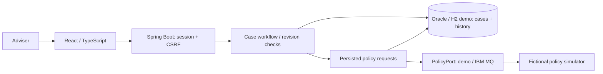

# Life & Pension Adviser Workspace

A small workspace for preparing pension and protection conversations: record
customer-declared facts, identify missing information, and track what changed.
**Fictional profiles only. Independent of Nordea; not financial advice.**

## Implemented: case workspace and simulated policy requests

- One adviser login with server-side sessions and CSRF-protected writes.
- Three synthetic cases: sole trader, employee, and career change.
- Create/edit profiles: age, employment, dependants, income, voluntary pension
  contribution, life cover, and meeting notes.
- Blank facts remain **unknown**, distinct from an explicitly declared zero.
- Draft → in review → closed, with return/reopen actions. Editing reviewed facts
  returns the case to draft; closed cases must be reopened before editing.
- Revision checks prevent overwriting changes made in another session.
- Each saved change records the adviser and a complete historical fact snapshot.

Step 2 adds correlated policy request/reply behind a transport port. The default
demo uses an **in-process queue, not IBM MQ**. An optional IBM MQ adapter and container
setup are included; live request/reply was verified with IBM MQ Developer 10.0.1.0
and the H2 demo database after user deployment.
**AI briefings are not implemented.** Case status represents meeting preparation,
not product suitability or approval.

Select a case's **Fictional policy fixture**, then **Request simulated policy**.
The response appears separately from the customer-declared profile:

- Requests persist with a correlation ID, case revision, adviser, and 60-second deadline.
- Publication retries until the deadline; duplicate/late replies do not overwrite results.
- Replies for changed cases are stale. Profile edits also invalidate previous snapshots.
- Timed-out or invalid replies display an explicit error; a new request uses a new ID.
- Fixture selection is an explicit demonstration choice, not a verified customer-policy link.

## Run the demo

Requires Docker Engine and Docker Compose. The demo uses persistent **H2 in Oracle
compatibility mode**, not an Oracle server.

```sh
docker compose --env-file /dev/null -f compose.demo.yaml up --build -d --wait
```

Open **http://localhost:8089**. Sign in with **`adviser` / `local-demo-password`**.

Try it: open **Synthetic: Mika, sole trader** → **Start review** → **Edit profile** →
enter a pension contribution → save. The case returns to draft. Expand **Case
history**, then review, close, and reopen the case.

Stop while preserving data:

```sh
docker compose --env-file /dev/null -f compose.demo.yaml down
```

Use `--volumes` only to deliberately erase that stack's cases and history.

## Run with Oracle

The separate Oracle stack uses `gvenzl/oracle-free:23.26.1-slim`, a community image
with application-user provisioning and a built-in health check. Review the
[Oracle terms](https://www.oracle.com/database/free/) and
[image documentation](https://hub.docker.com/r/gvenzl/oracle-free) before starting it.

```sh
cp .env.example .env
chmod 600 .env
# Replace placeholder passwords in .env with unique local passwords.
docker compose --env-file .env -f compose.oracle.yaml up --build -d --wait
```

Open **http://localhost:8090** with your configured adviser credentials.
Stop with the same command prefix followed by `down` instead of `up --build -d --wait`.

The Oracle and H2 stacks have **separate volumes**; they do not share or migrate
cases. Database ports are not exposed. Never commit `.env`; Docker administrators
can see environment credentials. Changing bootstrap passwords does not rotate
passwords in an existing database volume.

**Step 1 locally verified on Oracle:** migrations V1/V2, the original API smoke check, all five case browser
tests, and exact preservation of six cases and their history across Oracle/app restart.
**Caveat:** Flyway warns that Oracle 23.26 is newer than its tested support range.
Passing local checks is not vendor-certified compatibility. Automated CI uses H2 only.
The Step 2 policy migration V3 has been verified on H2 with live IBM MQ, but not on Oracle.

## Design



A modular monolith using Java 21, JDBC, and Flyway. Profile/status writes compare the
submitted revision in SQL and commit the new facts and history **together**, or roll
back both. EUR amounts persist as decimals with at most two decimal places.

The [case service](backend/src/main/java/fi/adviser/workspace/CaseService.java) owns
workflow and persistence; the [controller](backend/src/main/java/fi/adviser/workspace/CaseController.java)
defines the API. The [React UI](frontend/src/App.tsx) handles forms, loading, session
errors, and stale-request ordering without making workflow decisions.

History is append-only through the API, not tamper-proof against database
administrators. Initial synthetic fixtures predate history; subsequent changes are recorded.

### Optional IBM MQ lab

The simulator is a separate logical consumer in the same application, not a real
policy system or independently deployed service. MQ uses persistent request/reply
queues and transacted JMS receipt: processing commits before message acknowledgement.
There is no distributed DB/MQ transaction; duplicate delivery is expected and handled.
Pending requests are resent after restart, including when the demo's memory queues
were lost. Completed snapshots survive in the database and never overwrite declared facts.
Run **one app replica**; multi-replica publisher coordination is not implemented.

After reviewing the [IBM container licence instructions](https://github.com/ibm-messaging/mq-container/blob/master/docs/usage.md)
and [developer configuration](https://github.com/ibm-messaging/mq-container/blob/master/docs/developer-config.md),
create a private `.env.mq` containing `MQ_IMAGE` (a reviewed versioned Developer
image) and `MQ_LICENSE` (set to `accept` only after your own review).
The repository supplies no automatic acceptance value.

MQ's `app` password is supplied via a local file secret, not an admin credential:

```sh
mkdir -p secrets
chmod 700 secrets
read -r -s -p "Local MQ app password (at least 8 characters): " mq_password
printf '\n'
printf '%s' "$mq_password" > secrets/mq-app-password
unset mq_password
chmod 644 secrets/mq-app-password
chmod 600 .env.mq
APP_PORT=8092 docker compose --env-file .env.mq -p life-pension-mq \
  -f compose.demo.yaml -f compose.mq.yaml up --build -d --wait
```

The secret file must be readable by the different container UIDs; its parent directory
is private on the host. Never commit it. Open **http://localhost:8092** with the demo
adviser login. The policy panel must say **IBM MQ**. MQ ports/web console are not exposed.
Use the identical command prefix with `down` to stop while retaining both DB/MQ volumes.

To use Oracle instead of H2, combine `compose.oracle.yaml` and `compose.mq.yaml`
with an env file containing both sets of variables; keep a separate project/volume
from your existing Oracle workspace. That combination has not been live-verified.
Do not swap images or reuse queue-manager data across incompatible MQ versions.

Malformed JSON or mismatched JMS correlation is rolled back and retained; the worker
logs a sanitized warning. There is no automatic dead-letter/skip policy. An operator
must investigate retained poison messages. The requesting case eventually times out.
Readiness checks the app/database, not MQ; the policy request state exposes MQ lag/failure.

## Test

Step 1 verified: **11 backend tests, 3 frontend unit tests, and 5 browser tests**, plus live
API and restart checks. Coverage includes login/CSRF, validation, unknown vs zero,
workflow, concurrent/stale writes, rollback, historical snapshots, and mobile layout.

Step 2 brings the verified totals to **29 backend tests, 3 frontend unit tests,
9 browser tests, and 2 MQ configuration checks**. The live demo smoke passed.
Runtime checks also verified completed-snapshot persistence, recovery of the same
pending request after app recreation, and a real missing-simulator timeout.
JMS unit tests use mocks. Separately, the user-deployed IBM MQ Developer 10.0.1.0
lab passed the API smoke check and all three fictional policy fixtures. The API
reported `IBM_MQ`, broker channel message counts increased, and both persistent
queues drained. Replies preserved declared facts/history; a later profile edit
made the snapshot stale. This lab uses H2, not Oracle. MQ restart/outage recovery
was not tested; no containers were restarted or existing volumes removed.

The tested deployment used an unversioned image reference; pin a reviewed version
or image digest before recreating it. MQ reported plaintext communication, acceptable
only for this isolated local lab; production requires TLS and hardened configuration.

```sh
cd backend
mvn -B verify                 # Requires Java 21 and Maven.
cd ../frontend
npm ci
npm run lint
npm test
npm run build
cd ..

# Browser/smoke tests add synthetic cases: use a separate stack.
APP_PORT=8091 docker compose --env-file /dev/null -p life-pension-step1-test \
  -f compose.demo.yaml up --build -d --wait
APP_URL=http://127.0.0.1:8091 node scripts/smoke.mjs
node --test scripts/*.test.mjs
cd frontend
npx playwright install chromium
APP_URL=http://127.0.0.1:8091 npm run test:e2e
cd ..
APP_PORT=8091 docker compose --env-file /dev/null -p life-pension-step1-test \
  -f compose.demo.yaml down --volumes
```

[GitHub Actions](.github/workflows/ci.yaml) runs the same verification on a disposable demo.

## Scope

One adviser, fictional Finnish EUR profiles, local HTTP. No policy verification,
recommendations, suitability assessment, or live customer-data ingestion.
Do not enter real customer, health, policy, or financial information.
Production would require TLS, managed identity, retention/access controls, backups,
and legal/regulatory review.

Next: grounded AI briefings → human approval and evaluation → Kubernetes deployment.
